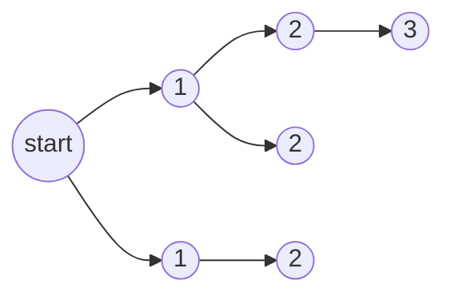

# Breadth First Search

Breadth first search takes the following basic form:

```
BFS(start):
    visited ← {start}
    queue   ← [start]

    while queue ≠ ∅:
        node ← queue.pop_front()
        process(node)                          -- hook 1: what you do with node

        for each neighbour of node:            -- hook 2: how you find neighbours
            if neighbour ∉ visited:
                visited.add(neighbour)
                queue.push_back(neighbour)     -- hook 3: what you do on discovery
```

A worklist is just a simple queue. What makes this algorithm BFS is that the queue is **FIFO**, so the first nodes processed are the closest to the starting point, and that the node is marked visited **when it's pushed, not when it's popped**. This prevents the node being visited multiple times.



_Nodes are processed in order of distance from `start` — all the 1s before any 2, all the 2s before any 3._

Now that the basic outline is done, we can explore common variants for the hooks.

## Hook one — what you do with the node

The simplest one is **early exit**: return the node you're looking for and that's it.

When you're trying to find the shortest path, you keep track of the nodes visited until you reach the target, then reconstruct the path (see hook three).

## Hook two — how you find neighbours

This is the graph flavour.

- **Static graph** — read an adjacency list.
- **Implicit graph** — compute the neighbours as you go (e.g. legal moves from a board position, triangles across each edge of a mesh triangle). The graph never exists in memory as a whole.

## Hook three — what you do on discovery

On discovery, record `parent[neighbour] ← node`. Because BFS discovers each node exactly once, along the shortest route, following `parent` back from the target to `start` reconstructs a shortest path afterwards.

```
path ← []
n ← target
while n ≠ start:
    path.push_front(n)
    n ← parent[n]
path.push_front(start)
```

## Depth First Search

We can swap the queue for a **stack**, so we have LIFO as opposed to FIFO. This then means that our search is now depth first search. Everything else — the three hooks, marking on push — stays the same.

```
DFS(start):
    visited ← {start}
    stack   ← [start]

    while stack ≠ ∅:
        node ← stack.pop_back()
        process(node)
        for each neighbour of node:
            if neighbour ∉ visited:
                visited.add(neighbour)
                stack.push_back(neighbour)
```

> [!note] The single difference
> BFS and DFS are the same algorithm with a different worklist. FIFO explores in rings outward from the start (shortest paths); LIFO dives down one branch as far as it goes before backing up.

---

## Connections

- [[kahns algorithm]] is this algorithm with one extra condition on hook three. Both keep a FIFO worklist, but BFS pushes a node the first time it is discovered, whereas Kahn's pushes only once `waiting_on` hits zero — the first parent versus the last. That one change turns "closest first" into "parents before children", and the leftover nodes turn from unreachable into cyclic.
- Sits with [[introduction to algorithms]], and is a rare case where the greedy-looking step is provably right: the FIFO order means a node is first discovered along a shortest route, so the `parent` chain needs no revisiting. Contrast the nearest neighbour tour in that note, which also takes the locally closest step and is wrong — the difference is that hop counts grow in rings and tour costs do not.
- `visited` is a set and `∉` is the membership test of [[sets]]; `parent` is a function from each discovered node to one predecessor, so the edges it records form a spanning tree of whatever is reachable. Stored as a bitmask, "not visited" is `U ∧ a(n) = 0` and marking is one OR — the atoms and masks of [[Bitset Auth]], where running this from every node is exactly the reachability closure $A^* = I \lor A \lor A^2 \lor \cdots$ that note builds.
- The cost argument is the counting bound of [[Monotonic Stack]]: marking on push means each node enters the worklist at most once and each edge is examined once, so the traversal is $O(V + E)$ no matter how the nesting looks. Both notes also make the same point about the container being the algorithm — swap FIFO for LIFO here and BFS becomes DFS, exactly as that note's stack discipline is what the whole method rests on.
- Marking on push, not on pop, is the same "reserve the state that says done" instinct as the identity-as-default conventions in [[Bit Encoding]] and [[Bitset Auth]]; mark on pop and a node already sitting in the queue gets pushed again by its next neighbour.
- BFS distance counts hops, which is not the straight-line distance of [[Euclidean space]] — two mesh vertices one edge apart can be far apart in space. Weighting the edges by that Euclidean length is what forces the FIFO queue to become a priority queue, i.e. Dijkstra.
- The implicit-graph case is the mesh one: the triangles of [[Cylinder]] and [[Sphere]] are index triples, and "the triangles sharing an edge with this one" is a neighbour function computed on demand rather than an adjacency list held in memory. [[Stripping Triangles]] — a strip as a walk through that dual graph — is not written yet.
- A graph where every node has exactly one neighbour is a [[Linked Lists|linked list]], and the `parent` chain this note walks back from the target is one — hook two degenerates to "follow `next`".
- The recursive form of DFS, call stack instead of explicit stack, is a recurrence with a base case: [[basic recursion for sum loop]].
- Part of [[Home]].

## Open

- [ ] [[Stripping Triangles]]: the mesh dual graph as hook two, and a strip as a walk through it.
- [ ] Dijkstra and A* as the same three hooks with a priority queue, and why the marking rule has to move to pop once edges have weights.
- [ ] The $O(V + E)$ bound written out with constants, as in [[Monotonic Stack]].
- [ ] Rust implementation of the three hooks as a trait or closures, over both a static adjacency list and an implicit graph.
